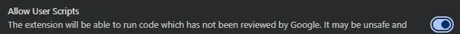

# Sign Brothers — SignAgent Tools

**Install the approved SignAgent tools in Chrome.** No GitHub or Chrome account sign-in is needed. You only sign in to SignAgent as usual.

## 1. Set up Tampermonkey (first time only)

1. Open the [official Tampermonkey Chrome Web Store page](https://chromewebstore.google.com/detail/tampermonkey/dhdgffkkebhmkfjojejmpbldmpobfkfo). Click **Add to Chrome**, then **Add extension**. If you already have Tampermonkey, skip this step.

   

2. In Chrome's address bar, enter **chrome://extensions**. Find **Tampermonkey → Details** and switch **Allow User Scripts** **ON**, as shown below. Leave the other settings alone.

   

3. Return to this GitHub page. **Tip:** Hold **Ctrl** while clicking a link (or **Command** on Mac) to open it in a new tab and keep these instructions available.

## 2. Install the SignAgent tools

Click each link below. When Tampermonkey opens its installation screen, choose **Install**. The screen may close afterward—that is normal.

1. **SignAgent Batch Place** — [Install / Update Batch Place](https://github.com/JPSignBros/SignAgentScripts-Install/raw/refs/heads/main/SignAgentBatchPlaceFriendlyNames.user.js)  
   Place several signs in a batch, with direction controls and readable labels. Tampermonkey may display its longer technical name, **SignAgent Batch Place + Friendly Names**; this is the correct installer.

2. **Resizable Sidebar** — [Install / Update Resizable Sidebar](https://github.com/JPSignBros/SignAgentScripts-Install/raw/refs/heads/main/SignAgentSidebarWidth.user.js)  
   Drag the Projects / Locations / Sign Types sidebar wider or narrower. Your chosen width is saved in this browser profile.

**Install both links above**, one at a time. Do not install the separate historical **SignAgentBatchPlace.user.js** file from GitHub's file list; Batch Place already includes it automatically.

## 3. You're done — check SignAgent

Open [SignAgent](https://app.signagent.com/) (or refresh it if already open). Look for the **Batch Place** controls in the upper-right corner:

Then try dragging the right edge of the Projects / Locations / Sign Types sidebar to resize it. Refresh SignAgent; your chosen width should remain. **You do not need to open the Tampermonkey dashboard.**

## If a tool doesn't appear

Refresh SignAgent, confirm Tampermonkey is enabled, and confirm **Allow User Scripts** is on. While on SignAgent, click the Tampermonkey toolbar icon to check that the two SignAgent tools are enabled. If a tool still fails, let the Sign Brothers team know.

## Updates

Tampermonkey can detect future approved versions using each script's public update settings. If a link opens **Reinstall** for a version you already have, you do **not** need to reinstall it just to check whether it's working; reinstallation may reset script settings.

Only the approved scripts linked on this page are intended for employee installation. Development builds and unfinished tools stay private.
